# SMG + Ollama lab

A hands-on lab for learning what an **LLM gateway** actually does, by putting one in front of a model running on your laptop and poking at it until it makes sense.

No GPU server, no cloud account, no API keys. Just Ollama, a tiny model (`qwen3:0.6b`, about 0.5 GB) and the SMG gateway, all on `127.0.0.1`.

It comes with an interactive guide you keep open next to your terminals: every step as a card with copy buttons and the output you should expect, a short animated reel per task explaining the idea, live status of your lab servers, and charts of your own results.

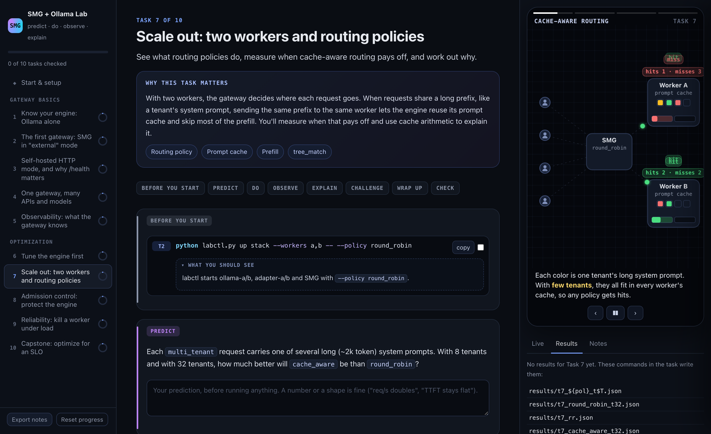

## The two pieces

**Ollama** is the *engine*. It loads a model and turns prompts into tokens. It's the easiest way to run an LLM locally, and it's great at that one job. What it doesn't do: spread traffic across several servers, protect itself from too many requests, notice when a server died, or tell you much about what's going on.

**SMG** ([Shepherd Model Gateway](https://github.com/lightseekorg/smg)) is the *gateway*. It sits between clients and engines and gives them one OpenAI- and Anthropic-compatible endpoint. Behind that endpoint it picks a worker for every request, queues or rejects what the engines can't handle, retries failures, takes broken workers out of rotation, and exports metrics for all of it. It's built to front real engines like vLLM and SGLang, which makes Ollama an interesting (and slightly awkward) partner, and that awkwardness is where a lot of the learning happens.

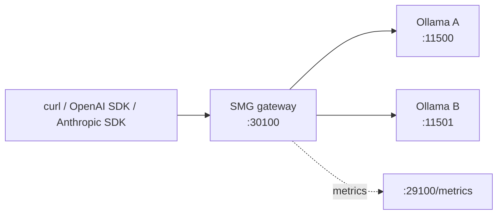

## What you'll come out understanding

- How a gateway registers workers, and why one missing endpoint (`/health`) changes everything
- How routing policies decide where requests go, and when `cache_aware` routing actually pays off
- What an engine's "slots" are, and how engine tuning and gateway tuning interact
- The difference between limiting, queueing and rate limiting, and when a fast 429 beats a slow answer
- What retries, health checks and circuit breakers do when you kill a server mid-load
- How to tune the whole stack against a real latency target and prove it with numbers

## A few things you'll trip over (on purpose)

The lab is built around surprises. A taste:

- Start SMG without an API key and it happily accepts a model name that doesn't exist.
- Point it at two Ollama servers, send 32 requests, and watch all 32 land on the same one.
- `/v1/chat/completions` works through the gateway, while `/v1/messages` says "not implemented"... until you switch modes.
- The gateway can't tell you time-to-first-token, even though that's the number your users care about most.

Every one of these has a reason, and each task walks you to it.

## Quick start

You need [Ollama](https://ollama.com) (`brew install ollama` on macOS, `curl -fsSL https://ollama.com/install.sh | sh` on Linux), Python 3 and a few GB of disk for the models.

```bash
git clone <this repo> smg_ollama_lab && cd smg_ollama_lab
bash setup.sh                  # checks Ollama, creates .venv, installs SMG + deps, downloads models, verifies
source .venv/bin/activate
```

Then pick your style:

- **Interactive:** `python3 labweb/server.py` opens the lab at http://127.0.0.1:8090: step-by-step cards, copy buttons, the output you should expect, short animated explainers for each task, live status of your lab servers and charts of your results. Keep it next to your terminals.
- **Plain markdown:** read `docs/01_concepts.md`, then follow `LAB_GUIDE.md` from Task 1.

Tested on macOS (Apple Silicon) with Ollama 0.32 and SMG 1.13.0. Linux works the same way. On Windows, use WSL2.

## The tasks

Every task follows the same loop: **predict, do, observe, explain, check.** Write your prediction down before running anything; being wrong is the fun part. You type the commands yourself, `python check.py N` confirms the results you saved, and `ANSWERS.md` has the explanations once you've had a go.

Each task has a 20-40 second reel in the interactive guide. Here they all are:

<table>
<tr>
<td align="center" width="33%" valign="top">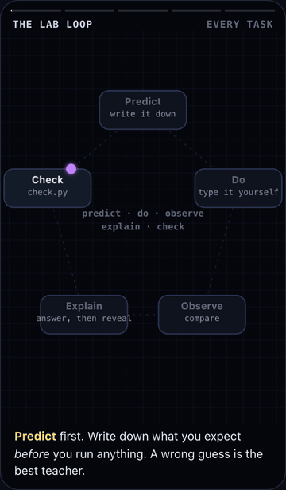<br><b>The lab loop</b><br><sub>predict, do, observe, explain, check</sub></td>
<td align="center" width="33%" valign="top">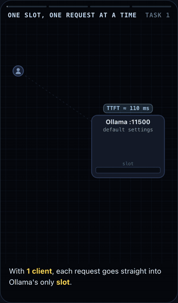<br><b>1 · Ollama alone</b><br><sub>the engine's APIs, its limits, a baseline</sub></td>
<td align="center" width="33%" valign="top">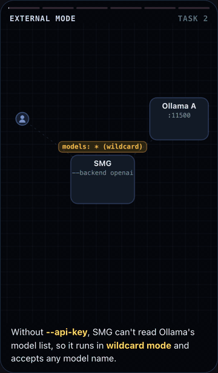<br><b>2 · SMG external mode</b><br><sub>gateway basics, auth, why external workers ignore policies</sub></td>
</tr>
<tr>
<td align="center" valign="top">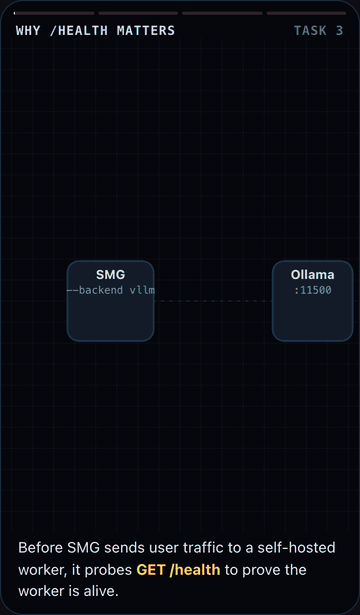<br><b>3 · Self-hosted HTTP mode</b><br><sub>worker registration, why <code>/health</code> matters (in the source), gateway overhead</sub></td>
<td align="center" valign="top">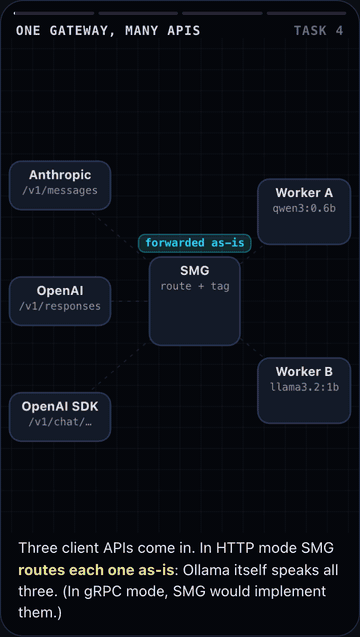<br><b>4 · APIs and models</b><br><sub>Anthropic/Responses translation, multi-model routing, aliases, tracing headers</sub></td>
<td align="center" valign="top">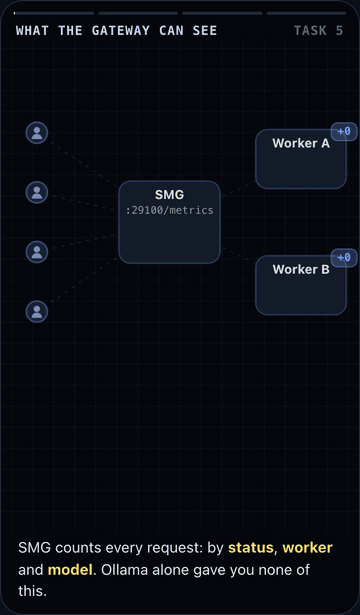<br><b>5 · Observability</b><br><sub>SMG metrics and logs, and what HTTP mode cannot measure</sub></td>
</tr>
<tr>
<td align="center" valign="top">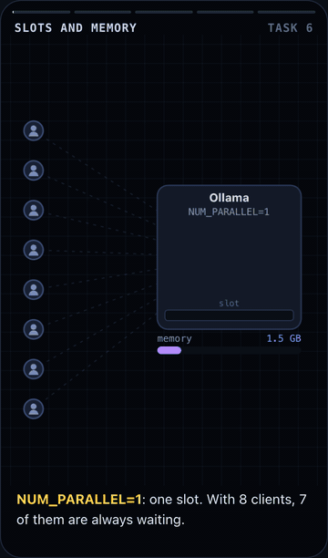<br><b>6 · Tune the engine</b><br><sub>Ollama slots, KV cache, memory vs throughput</sub></td>
<td align="center" valign="top">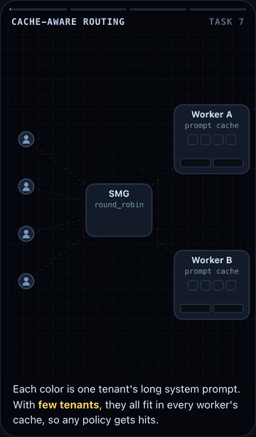<br><b>7 · Routing policies</b><br><sub>when cache-aware routing pays off, with cache arithmetic</sub></td>
<td align="center" valign="top">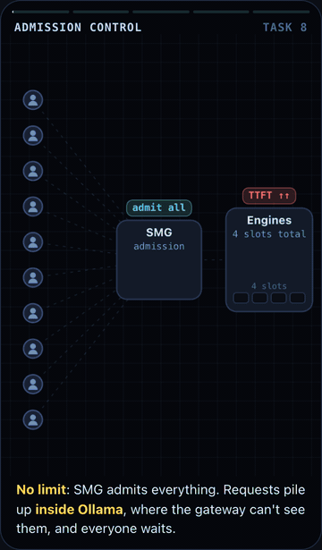<br><b>8 · Admission control</b><br><sub>limits, queues, rate limits, 429 vs latency</sub></td>
</tr>
<tr>
<td align="center" valign="top">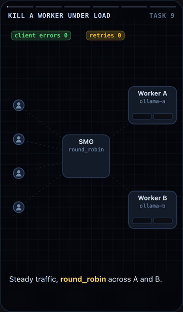<br><b>9 · Reliability</b><br><sub>killing workers under load: retries, health checks, circuit breakers</sub></td>
<td align="center" valign="top">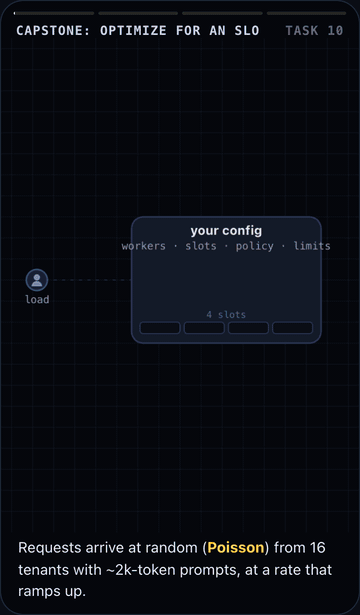<br><b>10 · Capstone</b><br><sub>optimize a config for a latency SLO, scored</sub></td>
<td></td>
</tr>
</table>

## What's in here

| Path | What |
|---|---|
| `LAB_GUIDE.md` | the tasks |
| `ANSWERS.md` | answers to every Explain question (no peeking first) |
| `labweb/` | the interactive version of the guide (`python3 labweb/server.py`); `record_reels.py` re-records the reel GIFs if you change a reel |
| `docs/` | concepts with diagrams, Ollama internals, optimization playbook, cheatsheet, reading SMG's source |
| `docs/media/` | the reel GIFs and screenshot used in this README |
| `labctl.py` | start/stop/status for the lab's servers (prints every command it runs, so you can see what's happening) |
| `bench.py` | load generator: TTFT, ITL, E2E, throughput |
| `metrics.py` | summary of the gateway's Prometheus metrics |
| `chaos.py` | steady load while killing and restoring servers |
| `capstone.py`, `capstone.env` | Task 10 scorer and the config you optimize |
| `check.py` | task completion checks |
| `scripts/ollama_adapter.py` | a tiny shim that adds `/health` so SMG's HTTP router can manage Ollama |
| `lab.env.example` | model names, ports, Ollama tuning (`setup.sh` copies it to `lab.env`) |

The lab runs its own Ollama servers on ports 11500/11501, separate from any Ollama app you already have on 11434. Your existing setup is never touched.

## Clean up

```bash
python labctl.py down all      # stops every lab server; your Ollama app on :11434 is never touched
```

## Where next

Ollama is a friendly engine but a limited one: no metrics, no `/health`, one request at a time by default. Once the ideas here click, the natural next step is putting SMG in front of an engine it was designed for, like vLLM or SGLang, where token-level routing and TTFT metrics become available. `LAB_GUIDE.md` ends with pointers.
