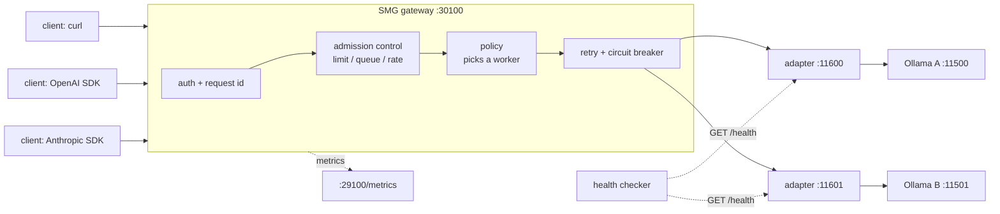
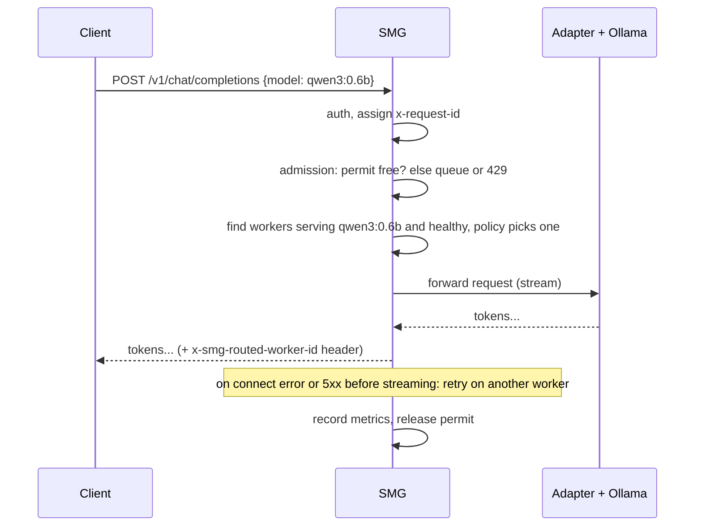
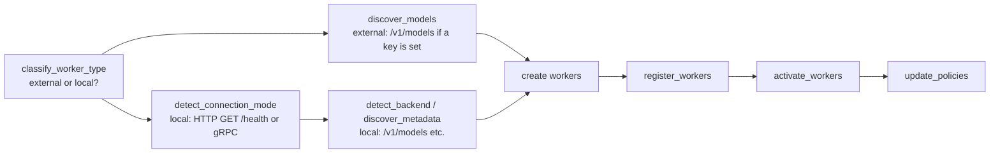

# 01 - Concepts (read before Task 1)

## What SMG is, in one sentence

SMG (Shepherd Model Gateway) is a gateway between your clients and your inference engines. Clients see one OpenAI- or Anthropic-compatible endpoint. Behind it, SMG decides which engine serves each request, protects the engines from overload, retries failures, and measures everything.

## Words used in this lab

| Word | Meaning here |
|---|---|
| **engine** | the program that runs the model: Ollama, vLLM, SGLang, TensorRT-LLM |
| **worker** | one engine instance that SMG routes to, identified by a URL |
| **gateway / router** | SMG itself |
| **registration** | SMG discovering a worker: probing it, reading its models, marking it ready |
| **policy** | the rule that picks a worker for each request (round_robin, cache_aware, ...) |
| **admission control** | deciding whether to accept, queue or reject a request *before* it reaches a worker |
| **TTFT** | time to first token: how long a user waits before text starts appearing |
| **ITL** | inter-token latency: time between streamed tokens |
| **E2E** | end-to-end latency of the whole request |
| **SLO** | a latency target, e.g. "95% of requests get their first token within 1.5 s" |
| **prefix cache** | the engine remembering the processed form (KV cache) of a prompt it has seen, so a repeat skips that work |

## The picture

## Why put a gateway in front of an engine at all?

An engine is good at one thing: turning prompts into tokens fast on one machine. Everything around that is the gateway's job:

1. **One address, many engines.** Clients do not know or care how many workers exist, where they are, or which model runs where.
2. **Smart placement.** Send a request to the worker that already has its prompt cached (`cache_aware`), or to the least busy one.
3. **Protection.** Cap how much work reaches each engine; queue or reject the rest instead of letting latency explode for everyone.
4. **Failure hiding.** Detect dead workers, stop sending them traffic, and retry the requests that failed.
5. **API translation.** Speak OpenAI Chat, OpenAI Responses and Anthropic Messages to clients, whatever the engine speaks.
6. **Visibility.** One place with request counts, latencies, errors and retries for the whole fleet.

## Two ways SMG can treat a worker

This lab shows both, because Ollama sits right at the boundary between them.

| | **external** (`--backend openai`) | **self-hosted, HTTP** (`--backend vllm` / `sglang`) |
|---|---|---|
| Meant for | providers you do not run (OpenAI, Anthropic, vendors) | engines you run |
| Registration needs | nothing; it accepts the URL | `GET /health` = 200, then `/v1/models` |
| Worker choice | least in-flight requests; `--policy` is ignored | your `--policy` |
| `/v1/models` on the gateway | external models are not listed | lists self-hosted models |
| Anthropic `/v1/messages` | not implemented in 1.13 | translated by SMG |
| Retries and circuit breaker | basic | full |
| Lab tasks | Task 2 | Tasks 3-10 (via `scripts/ollama_adapter.py`) |

A third mode, **gRPC**, needs an engine with SMG's gRPC servicer (vLLM, SGLang, TensorRT-LLM). In that mode SMG tokenizes requests and parses tool calls and reasoning itself, so it can report TTFT and route on tokens. Ollama cannot do this; see `smg-vllm-lab`.

## What happens to one request

## How SMG registers a worker

When SMG starts (or when you `POST /workers`), it runs a *workflow* of steps. You see them in the log as `Step started ... step_id=...`:

Task 3 is about the `detect_connection_mode` step: it is why raw Ollama cannot be a self-hosted worker.

## What the engine (Ollama) does

See `docs/02_ollama_engine.md`. In short: Ollama runs `llama-server` (llama.cpp) per loaded model, with a fixed number of **slots** (`OLLAMA_NUM_PARALLEL`) that decode together, and a **prompt cache** that keeps recently used prompts so repeats skip prefill.

## The one idea to keep

The engine decides how fast *one machine* turns prompts into tokens. The gateway decides *which machine* does the work, *whether* the work is accepted, and *what happens when a machine fails*. You tune both, in that order: engine first (Task 6), then gateway (Tasks 7-9).
